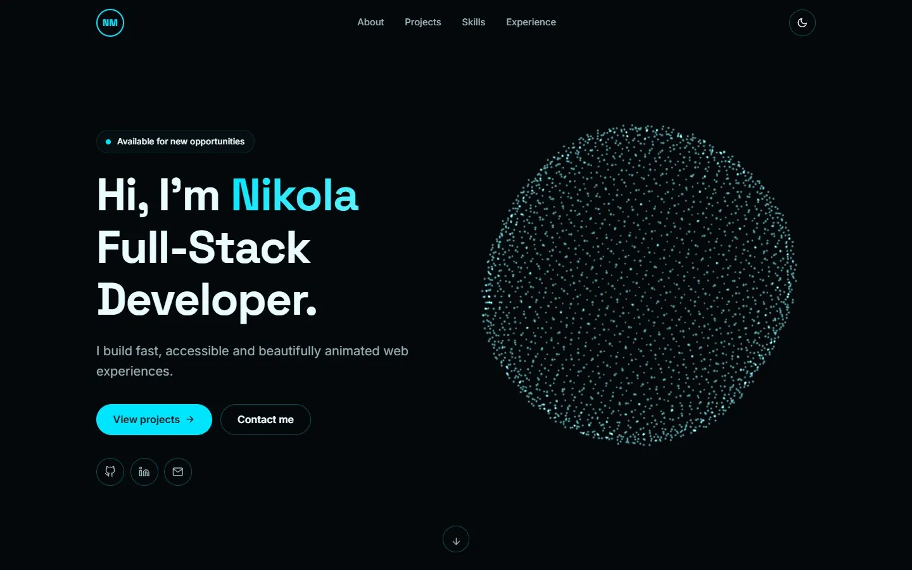
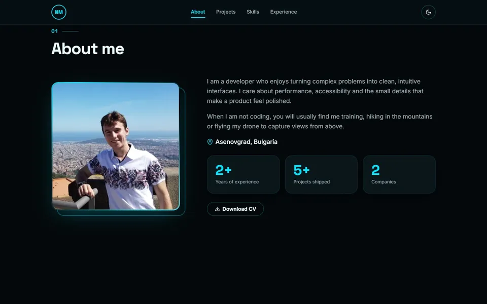
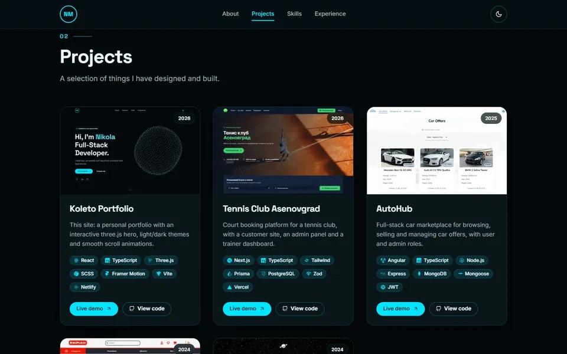
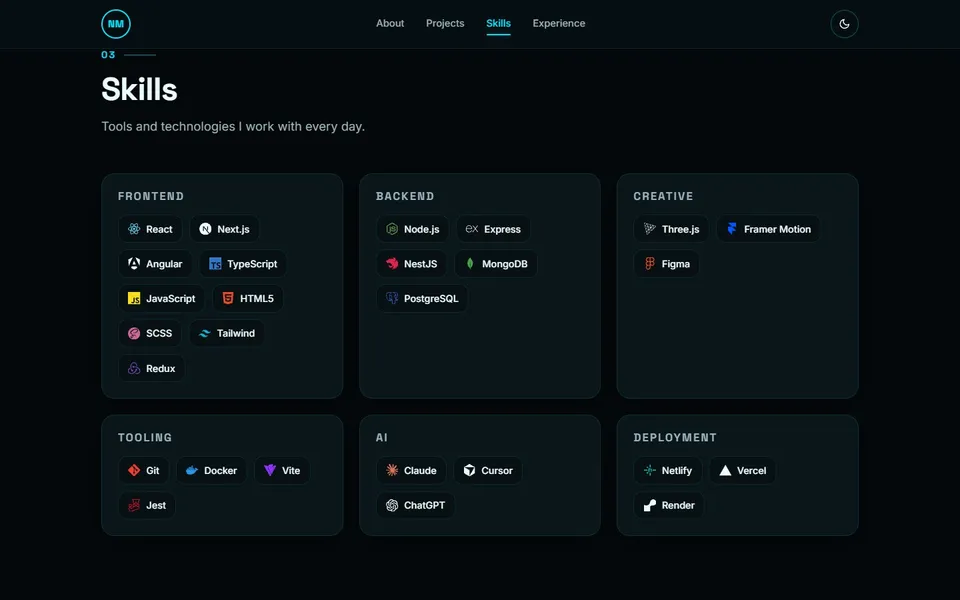
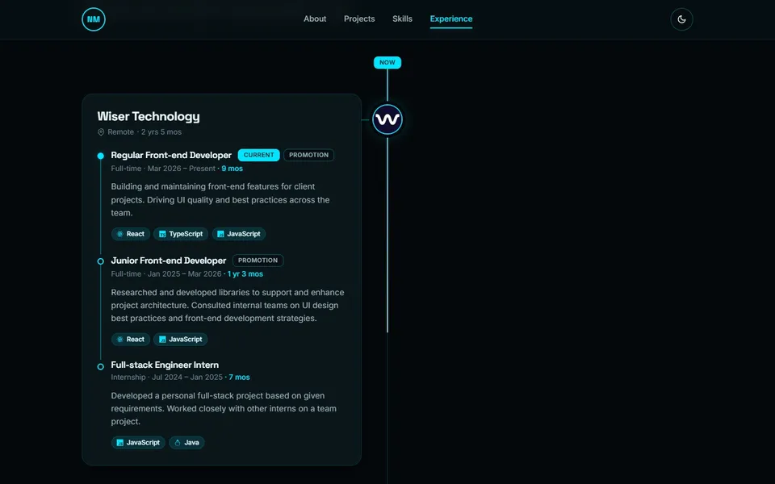
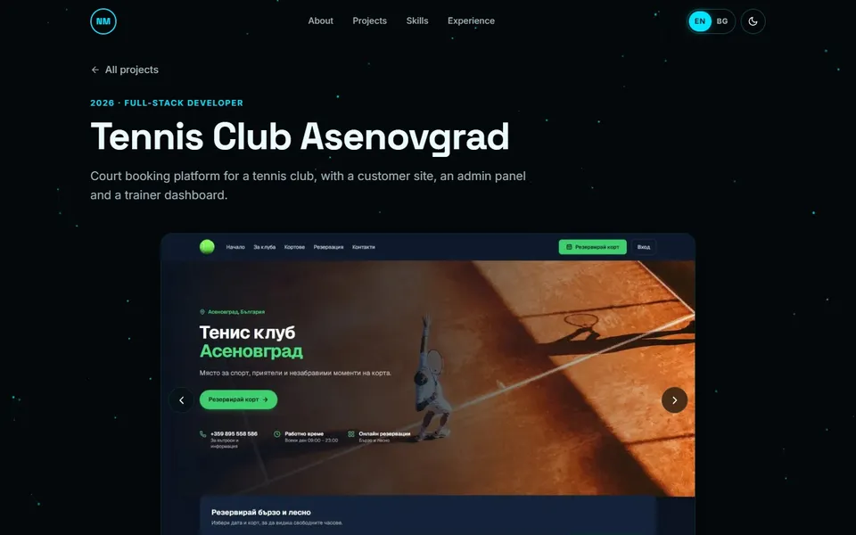
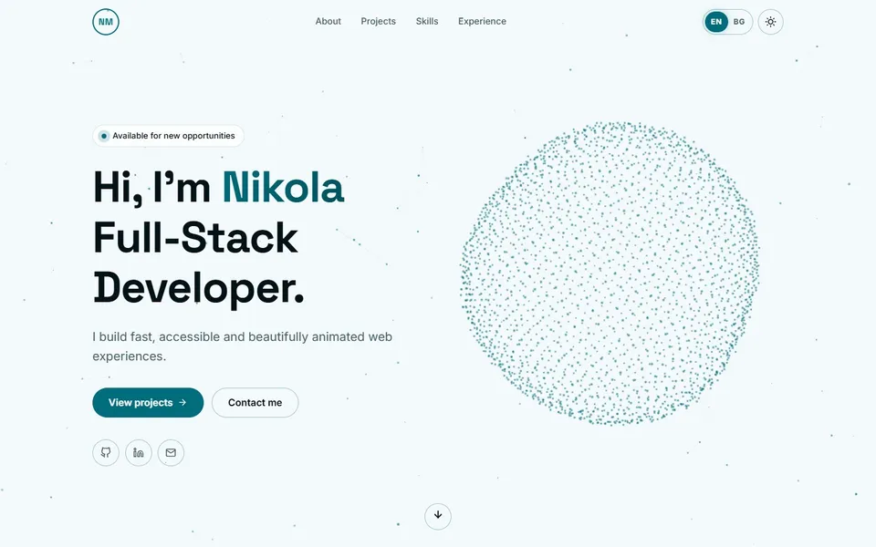
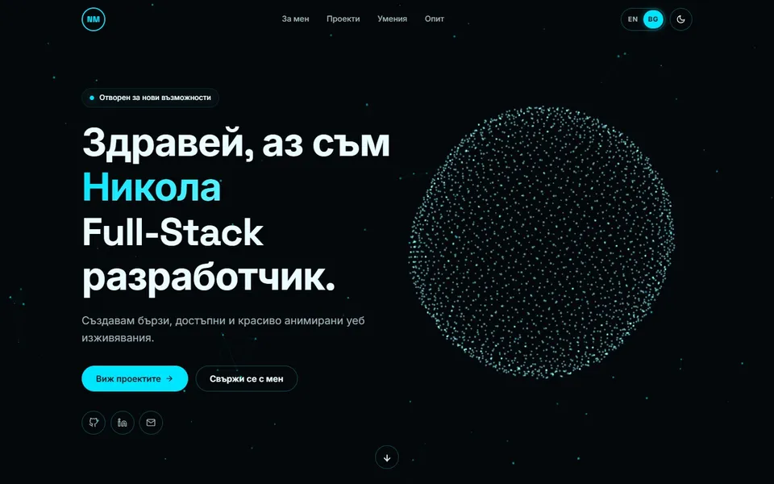
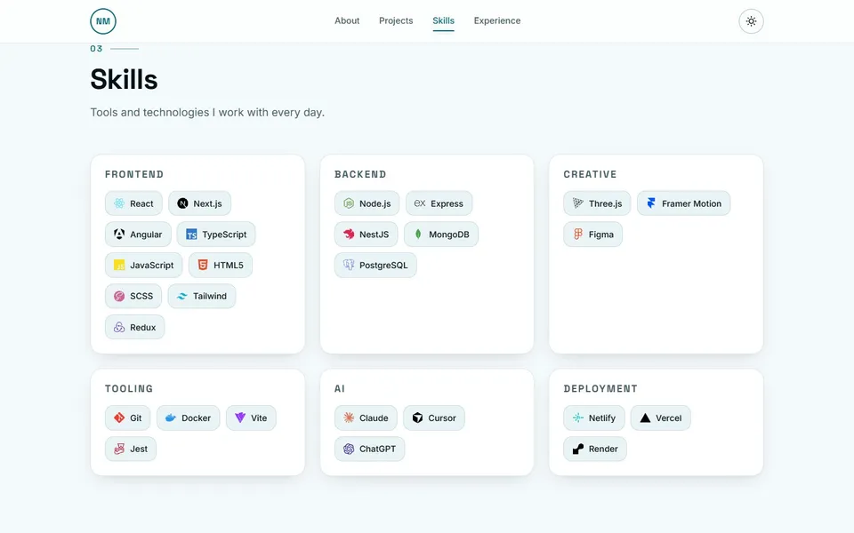

# Koleto — Portfolio

**Live: [koleto.eu](https://koleto.eu)**

My personal developer portfolio: a fast, fully responsive single-page app with an interactive three.js hero, smooth scroll animations and light/dark themes.

<!-- Screenshots are the site's own optimized gallery images (generated from images-src/ by `npm run images`) -->


## Features

- **Intro loader:** "KOLETO" fades in letter by letter, then reveals the site. It's plain HTML/CSS in `index.html`, so it paints before any JavaScript loads.
- **Interactive 3D hero:** a particle sphere (three.js / React Three Fiber) that assembles on load, breathes, and parts exactly under the cursor. It loads on idle after the page appears.
- **Ambient particle background:** a lightweight 2D canvas of drifting, connected particles across every page.
- **English & Bulgarian:** every piece of text, including project and experience content, is translated. An EN | BG switch sits in the navbar (and in the mobile menu); the site always opens in English, and a switch to Bulgarian is remembered for later visits. Translations are type-checked, and the build fails if the two languages ever drift apart.
- **Light & dark themes:** high-contrast cyan palette, saved preference, no flash of the wrong theme, smooth cross-fade (View Transitions API).
- **Projects:** cards with tech chips, icons, **Live demo** and **View code** buttons, a 3D tilt and a cursor spotlight. Each project has its own page (`/projects/:slug`) with a swipeable gallery.
- **Experience timeline:** an alternating left/right timeline with promotions grouped under one company (LinkedIn-style). The line fills as you scroll.
- **Scroll reveals & micro-interactions** with Framer Motion. Respects `prefers-reduced-motion`.
- **Skills:** grouped cards with official brand-coloured icons (Frontend, Backend, Creative, Tooling, AI, Deployment).
- **Responsive & cross-browser:** mobile-first, fluid typography with `clamp()`, Autoprefixer; tested in Chrome and Firefox.
- **Fast:** self-hosted fonts, responsive WebP images, code-split routes, three.js loaded on idle.
- **SEO:** `robots.txt`, a sitemap generated at build time, canonical URL and Open Graph image.
- **No backend:** structure lives in typed files in `src/data/`, text in `src/i18n/locales/`.

| About | Projects |
| --- | --- |
|  |  |

| Skills | Experience |
| --- | --- |
|  |  |

| Project page | Light theme |
| --- | --- |
|  |  |

| Bulgarian | Light theme: skills |
| --- | --- |
|  |  |

## Tech stack

- **React 18** + **TypeScript**, built with **Vite**
- **React Router** for project detail pages
- **SCSS** in the **7-1 architecture**, with theming through CSS custom properties
- **Framer Motion** for animations
- **three.js** + **@react-three/fiber** for the 3D hero (lazy-loaded)
- **react-icons** for technology and UI icons
- Deployed on **Netlify**

## Getting started

```bash
npm install
npm run dev      # http://localhost:5173
npm run build    # type-check + production build to dist/
npm run preview  # serve dist/ locally
```

Requires Node.js 18+.

## Project structure

```
src/
├── data/        content + types (the "backend")
├── components/  Navbar, LanguageSwitcher, ParticlesBackground, HeroScene, ProjectCard, ExperienceTimeline, Gallery…
├── sections/    Hero, About, Projects, Skills, Experience
├── pages/       Home, ProjectDetail, NotFound
├── context/     ThemeContext
├── i18n/        LanguageContext, t() helpers, locales/en.json + bg.json
├── hooks/       useActiveSection, useCssVar
└── styles/      7-1 architecture
    ├── abstracts/   variables, breakpoints, functions, mixins
    ├── base/        reset, typography, globals
    ├── components/  buttons, cards, chips, loader, gallery, timeline…
    ├── layout/      navbar, sections, grids, footer
    ├── pages/       hero, about, project page
    ├── themes/      _dark.scss, _light.scss
    ├── vendors/     third-party overrides
    └── main.scss
```

## Editing content

Structure (links, images, dates, tech) lives in `src/data/`; **all text** lives in `src/i18n/locales/en.json` and `bg.json`, keyed by the same ids.

| What | Structure | Text (both locale files) |
| --- | --- | --- |
| Socials, email, photo, CV link | `src/data/profile.ts` | `content.profile` (name, role, bio, location) |
| Projects (cards + detail pages) | `src/data/projects.ts` | `content.projects.<slug>` |
| Skills | `src/data/skills.ts` | `skills.groups.<id>` |
| Experience timeline | `src/data/experience.ts` | `content.experience.<company id>.roles.<role id>` |
| UI labels (nav, buttons, headings…) | — | the other top-level sections |
| Technology names & icons | `src/data/tech.ts` | — (brand names) |
| Theme colours | `src/styles/themes/_dark.scss`, `_light.scss` | — |

- **Project images:** put original screenshots in `images-src/projects/<project>/`, then run `npm run images`. That generates responsive WebP files (480/720/960/1600px) in `public/images/projects/`. In `projects.ts`, reference them by name without the extension, e.g. `tennis('01-home')`. The first image is the card thumbnail.
- **Translations:** use `const { t } = useI18n()` and `t('section.key', { name })` in components; keys are type-checked against `en.json`. Styled words go inside tags (`"Let's build something <accent>great</accent>"`) and are rendered with `rich()`. To add a language, add a locale file and its code to `LANGS` in `src/i18n/messages.ts`.
- **Company logos** go in `public/images/companies/` (`logo: '/images/companies/acme.png'`). Without a logo, the company's initials are shown.
- **Promotions:** list several roles under one company (newest first) and they're connected automatically.
- **New technologies:** add an id to `TechId` in `types.ts`, then an entry in `tech.ts` (icons from `react-icons/si`).

## Forced dark mode in mobile browsers

The site has its own light and dark themes and declares both with `<meta name="color-scheme" content="dark light">`. Some browsers can still repaint pages with their own "force dark" filter:

| Browser | Behaviour |
| --- | --- |
| Safari (iOS), Firefox (Android) | No forced dark mode; the site's themes show as designed. |
| Chrome (Android) | "Auto dark mode for web contents" is opt-in and respects the `color-scheme` meta tag, so it leaves this site alone. |
| Edge / Opera (Android) | Optional "force dark pages" settings; mostly respect `color-scheme`. |
| **Samsung Internet** | Its dark mode can repaint sites even when they have their own dark theme. Newer versions' adaptive mode respects `color-scheme`, but the default can still override it, and a site can't fully opt out. Fix on the device: **Settings → Dark mode** (or **Labs**) → turn off **"Force dark mode for web content"** / enable **"Use website dark theme"**. |

## Deployment (Netlify + custom domain)

1. In Netlify: **Add new site → Import from Git**, then pick this repo. Use build command `npm run build` and publish directory `dist`.
   (`public/_redirects` makes `/projects/...` URLs work on refresh.)
2. **Domain management → Add a domain**, then enter your domain.
3. At the domain registrar (e.g. SuperHosting.bg), either:
   - keep DNS there: add an `A` record for `@` pointing to `75.2.60.5` and a `CNAME` for `www` pointing to `<your-site>.netlify.app`, **or**
   - switch the nameservers to the ones Netlify provides.
4. Once DNS propagates, Netlify issues a free HTTPS certificate automatically.

## License

**All rights reserved.** © 2026 Nikola Mihaylov.

The source is public for viewing and reference only. Copying, deploying, modifying, redistributing or selling this project, or any part of its code, design or content, is not permitted without written permission. See [LICENSE](LICENSE) for details.
