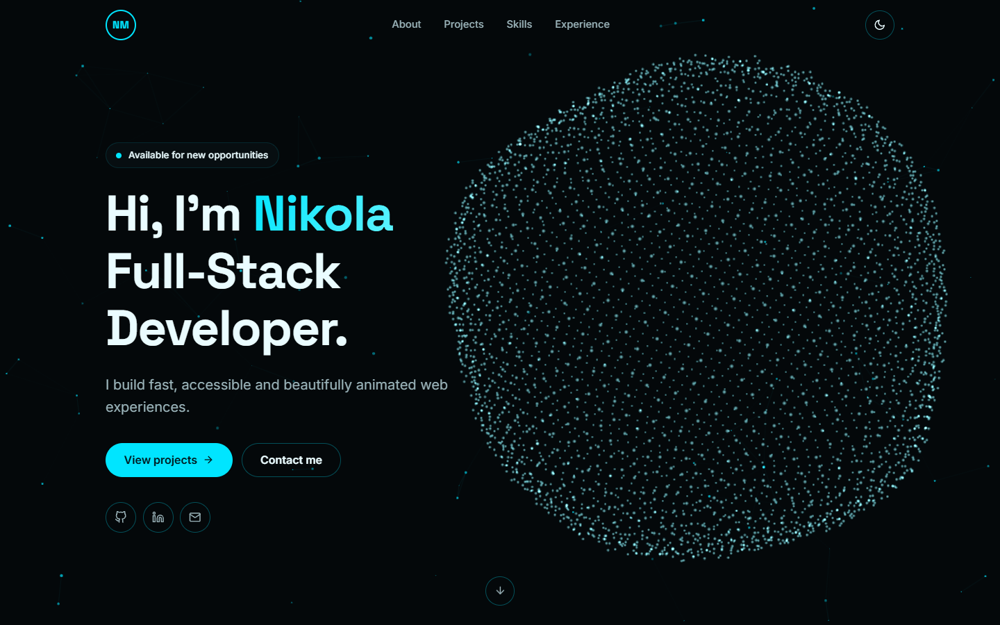
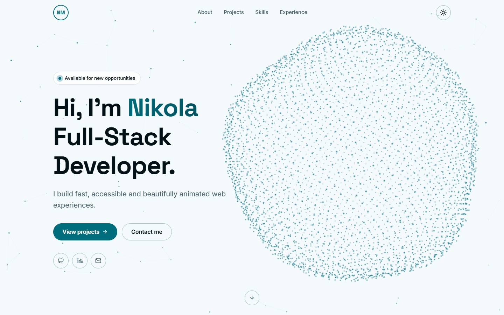
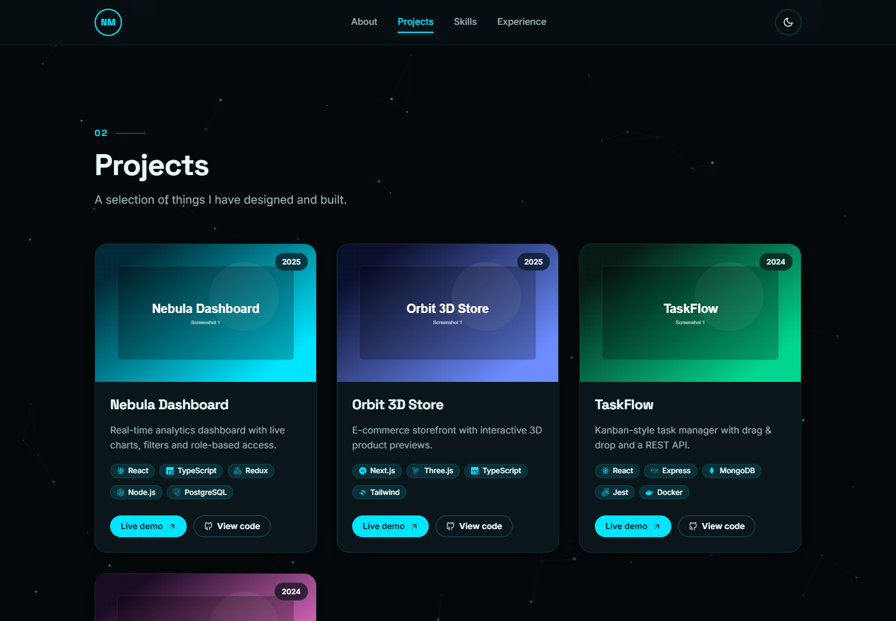
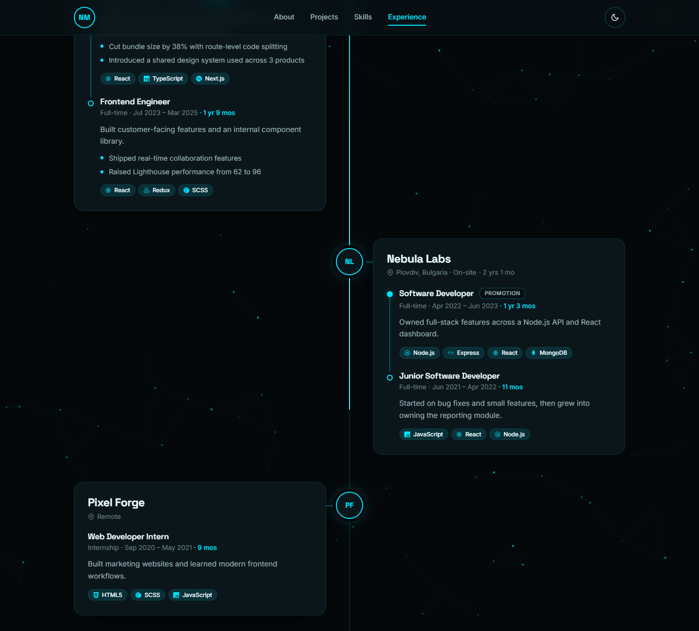
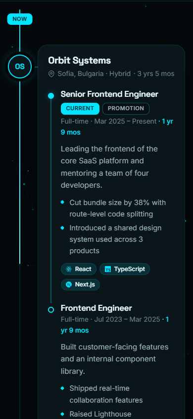

# Koleto — Portfolio

My personal developer portfolio: a fast, fully responsive single-page app with an interactive three.js hero, smooth scroll animations and light/dark themes.



## Features

- **Intro loader:** "KOLETO" fades in letter by letter, then reveals the site.
- **Interactive 3D hero:** a particle sphere (three.js / React Three Fiber) that assembles on load, breathes and scatters away from the cursor.
- **Ambient particle background:** a lightweight 2D canvas of drifting, connected particles across every page.
- **Light & dark themes:** high-contrast cyan palette, saved preference, no flash of the wrong theme, smooth cross-fade (View Transitions API).
- **Projects:** cards with tech chips, icons, **Live demo** and **View code** buttons, a 3D tilt and a cursor spotlight. Each project has its own page (`/projects/:slug`) with a swipeable gallery.
- **Experience timeline:** an alternating left/right timeline with promotions grouped under one company (LinkedIn-style). The line fills as you scroll.
- **Scroll reveals & micro-interactions** with Framer Motion. Respects `prefers-reduced-motion`.
- **Responsive & cross-browser:** mobile-first, fluid typography with `clamp()`, Autoprefixer.
- **No backend:** all content lives in typed files in `src/data/`.

| Light theme | Projects |
| --- | --- |
|  |  |

| Experience (desktop) | Experience (mobile) |
| --- | --- |
|  |  |

## Tech stack

- **React 18** + **TypeScript**, built with **Vite**
- **React Router** for project detail pages
- **SCSS** in the **7-1 architecture**, with theming through CSS custom properties
- **Framer Motion** for animations
- **three.js** + **@react-three/fiber** for the 3D hero (lazy-loaded)
- **react-icons** for technology and UI icons
- Deployed on **Netlify**

## Getting started

```bash
npm install
npm run dev      # http://localhost:5173
npm run build    # type-check + production build to dist/
npm run preview  # serve dist/ locally
```

Requires Node.js 18+.

## Project structure

```
src/
├── data/        content + types (the "backend")
├── components/  Loader, Navbar, ParticlesBackground, HeroScene, ProjectCard, ExperienceTimeline, Gallery…
├── sections/    Hero, About, Projects, Skills, Experience
├── pages/       Home, ProjectDetail, NotFound
├── context/     ThemeContext
├── hooks/       useActiveSection, useCssVar
└── styles/      7-1 architecture
    ├── abstracts/   variables, breakpoints, functions, mixins
    ├── base/        reset, typography, globals
    ├── components/  buttons, cards, chips, loader, gallery, timeline…
    ├── layout/      navbar, sections, grids, footer
    ├── pages/       hero, about, project page
    ├── themes/      _dark.scss, _light.scss
    ├── vendors/     third-party overrides
    └── main.scss
```

## Editing content

| What | File |
| --- | --- |
| Name, bio, socials, email, CV link | `src/data/profile.ts` |
| Projects (cards + detail pages) | `src/data/projects.ts` |
| Skills | `src/data/skills.ts` |
| Experience timeline | `src/data/experience.ts` |
| Technology names & icons | `src/data/tech.ts` |
| Theme colours | `src/styles/themes/_dark.scss`, `_light.scss` |

- **Project images:** put original screenshots in `images-src/projects/<project>/`, then run `npm run images`. That generates responsive WebP files (480/960/1600px) in `public/images/projects/`. In `projects.ts`, reference them by name without the extension, e.g. `tennis('01-home')`. The first image is the card thumbnail.
- **Company logos** go in `public/images/companies/` (`logo: '/images/companies/acme.png'`). Without a logo, the company's initials are shown.
- **Promotions:** list several roles under one company (newest first) and they're connected automatically.
- **New technologies:** add an id to `TechId` in `types.ts`, then an entry in `tech.ts` (icons from `react-icons/si`).

## Deployment (Netlify + custom domain)

1. In Netlify: **Add new site → Import from Git**, then pick this repo. Use build command `npm run build` and publish directory `dist`.
   (`public/_redirects` makes `/projects/...` URLs work on refresh.)
2. **Domain management → Add a domain**, then enter your domain.
3. At the domain registrar (e.g. SuperHosting.bg), either:
   - keep DNS there: add an `A` record for `@` pointing to `75.2.60.5` and a `CNAME` for `www` pointing to `<your-site>.netlify.app`, **or**
   - switch the nameservers to the ones Netlify provides.
4. Once DNS propagates, Netlify issues a free HTTPS certificate automatically.

## License

**All rights reserved.** © 2026 Nikola Mihaylov.

The source is public for viewing and reference only. Copying, deploying, modifying, redistributing or selling this project, or any part of its code, design or content, is not permitted without written permission. See [LICENSE](LICENSE) for details.
